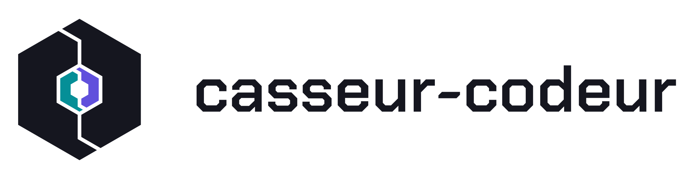

  <picture>
    <source media="(prefers-color-scheme: dark)" srcset="assets/logo-dark.svg">
    
  </picture>

<b>On casse, on code, on recommence.</b>

<a href="README.md">English version</a>

---

Casseur-codeur, c'est deux potes associés qui construisent les outils dont ils ont envie, puis les partagent. Des projets perso, faits avec soin.

### Projets

| Projet | Ce que c'est | Statut |
|---|---|---|
| **[AppCook](https://github.com/Casseur-codeur/appcook)** | Livre de recettes et liste de courses pour la maison. [Démo en ligne](https://onjf.julienlambs.dev) | Public |
| **Be Dangerous** | Compagnon pour Elite Dangerous : copilote vocal en français, cockpit sur tablette et préparation de trajets, gratuit | Privé, ouverture prévue |
| **Gaston** | Bot Discord qui prend des notes pendant les appels vocaux | Tout début |

### Qui on est

- **Julien** · [@julienlambs](https://github.com/julienlambs) · [julienlambs.dev](https://julienlambs.dev)
- **Snooze** · [@snoozeDev](https://github.com/snoozeDev)
