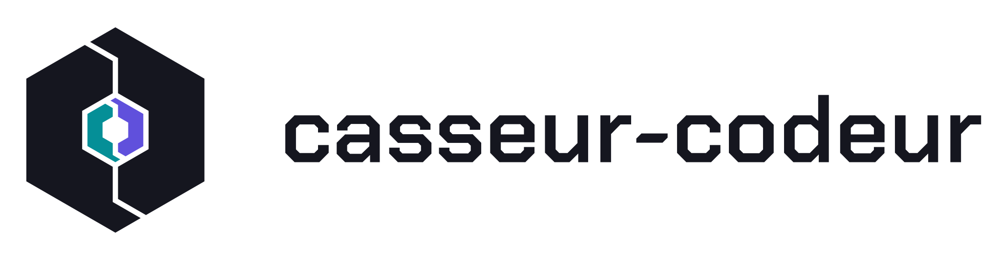

  <picture>
    <source media="(prefers-color-scheme: dark)" srcset="assets/logo-dark.svg">
    
  </picture>

<b>We break things, then we code them back together.</b>

<a href="README.fr.md">Version française</a>

---

Casseur-codeur is two friends and partners building the tools we want for ourselves, then sharing them. Side projects, made with care.

### Projects

| Project | What it is | Status |
|---|---|---|
| **[AppCook](https://github.com/Casseur-codeur/appcook)** | Recipe book and shopping list for the household. [Live demo](https://onjf.julienlambs.dev) | Public |
| **Be Dangerous** | Elite Dangerous companion: French voice copilot, tablet cockpit and route planning, free to use | Private, opening planned |
| **Gaston** | Discord bot that takes notes during voice calls | Early stage |

### Who we are

- **Julien** · [@julienlambs](https://github.com/julienlambs) · [julienlambs.dev](https://julienlambs.dev)
- **Snooze** · [@snoozeDev](https://github.com/snoozeDev)
